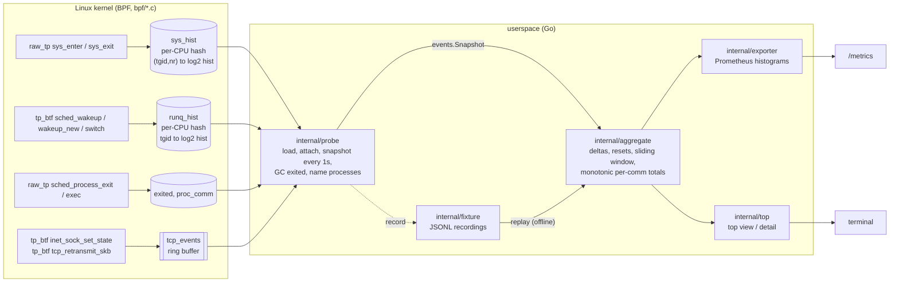

# sysprobe

An eBPF profiler for Linux that answers "which process is waiting on the
kernel, for what, and for how long?", exported as Prometheus histograms and a
top-style terminal view.

[](https://github.com/lutherleo/sysprobe/actions/workflows/ci.yml)

Go ([cilium/ebpf](https://github.com/cilium/ebpf) v0.22) for userspace, C for
the BPF programs, compiled with clang 19 in a pinned Linux builder image
(macOS clang has no BPF backend). The compiled objects are committed, so the
Go code builds and tests on any OS without clang or Docker.

## Why

`strace -c` tells you which syscalls a process makes, but it stops the
process on every call and is far too slow to leave running. A full
continuous-profiling stack answers the question, but it is a platform to
deploy. sysprobe sits in between: one static binary that keeps per-process
syscall and scheduler latency histograms in the kernel at a fixed cost per
event, and can be scraped by Prometheus or watched in a terminal.

## Features

- **Per-process syscall latency histograms** (enter to exit, per syscall),
  aggregated in the kernel into per-CPU log2 histograms.
- **Run-queue latency** per process (runnable to running), the runqlat
  algorithm on BTF tracepoints.
- **TCP connect latency, failed connects and SYN retransmits** per
  destination, streamed individually through a BPF ring buffer.
- **Prometheus exporter** (`sysprobe run`, `/metrics` and `/healthz`) with
  bucket edges identical to the kernel's, bounded `comm` labels and counters
  that never go backwards.
- **Interactive top view** (`sysprobe top`): processes sorted by time spent
  in syscalls, call rate, p99 or run-queue latency, plus TCP destinations and
  recent TCP events; `replay -pid N` adds a per-syscall breakdown of one
  process with ASCII latency histograms.
- **Record and replay**: `sysprobe record` writes the snapshot stream to a
  JSONL fixture; `sysprobe replay` runs the exact same aggregation, exporter
  and view offline, without privileges, on any OS.
- **`sysprobe doctor`**: checks kernel version, privileges, BTF and each
  tracepoint per collector, so you know what will load before you try.
- **Kernel drop accounting**: every sample the BPF side cannot store
  (allocator exhausted, missed start timestamp, ring buffer full) is counted
  and exported as `sysprobe_bpf_drops_total`.

## Status

Verified end to end on two kernels, both virtual machines:

- **Linux 7.0.14-linuxkit, aarch64**, in a privileged container on Docker
  Desktop for macOS. The recordings in `testdata/` and the transcript
  `integration/results/7.0.14-linuxkit.txt` come from that run, and every
  offline test and `make demo` use them.
- **Linux 7.0.0-1017-azure, x86_64**, the GitHub-hosted `ubuntu-latest`
  runner, where the CI `integration` job runs the same privileged test with
  `sudo` on every push and uploads its transcript and recordings as a
  workflow artifact (not committed).

No production use is claimed.

## Architecture



Data flows one way: the kernel keeps **cumulative** histograms; once per
interval the probe reads every map into an `events.Snapshot` (cumulative
histograms + new TCP events + kernel drop counters). The aggregator differences
consecutive readings and feeds three consumers: a per-process sliding window
(the top view), per-process lifetime totals, and per-comm totals that never
decrease (the exporter). A recorded fixture is just a stream of those
snapshots, which is why replay exercises exactly the same code as live use.
Design details, algorithms and complexity: [docs/ARCHITECTURE.md](docs/ARCHITECTURE.md).

## Quick start

Prerequisites:

- **Go 1.27.1** (the version in `go.mod`; with `GOTOOLCHAIN=auto`, the
  default, any Go 1.21+ downloads it on first use).
- For `make check` only: **golangci-lint v2.13.2**, the version CI pins.
- For live collection: **Linux as root** (or `CAP_BPF` + `CAP_PERFMON`),
  kernel >= 4.17 for `syscalls`, >= 5.5 with BTF for `runq`, >= 5.8 with BTF
  for `tcp` ([docs/KERNEL.md](docs/KERNEL.md)).
- For `make integration` and `make bpf`: **Docker**.

Offline, on macOS or Linux (no root, clang or Docker):

```sh
git clone https://github.com/lutherleo/sysprobe.git
cd sysprobe
go test ./...                        # every offline test; no linter, root or Docker needed
make demo                            # replay the fixtures recorded on a real kernel
go build -o sysprobe ./cmd/sysprobe
./sysprobe replay -rows 5 -sort p99 testdata/recorded/demo-7.0.14-linuxkit.jsonl
```

The full gate, as CI runs it (install golangci-lint first, e.g. with the
same command the workflow uses:
`curl -sSfL https://raw.githubusercontent.com/golangci/golangci-lint/v2.13.2/install.sh | sh -s -- -b "$(go env GOPATH)/bin" v2.13.2`):

```sh
make check      # gofmt, go vet (host + GOOS=linux), golangci-lint (host + linux), tests -race, coverage gate
```

Live, on Linux as root:

```sh
go build -o sysprobe ./cmd/sysprobe
sudo ./sysprobe doctor                 # which collectors this kernel supports
sudo ./sysprobe top                    # interactive: s=sort  e=exited  p=pause  q=quit
sudo ./sysprobe run -listen :9464      # Prometheus on /metrics, /healthz
sudo ./sysprobe record -o cap.jsonl -duration 30s
./sysprobe replay -pid 1234 -metrics cap.jsonl   # anywhere, no privileges
```

`doctor` runs anywhere but only reports collectors as ready on Linux; on
macOS it lists every requirement as missing and exits 1.

From macOS with Docker (what produced the committed recordings):

```sh
make integration   # builder image, privileged --pid=host container, records fixtures + transcript
make bpf           # recompile bpf/*.c into internal/probe/*_bpfel.o (committed)
```

`make integration` prints `SKIP integration: Docker is not available` and
exits 0 when there is no Docker daemon.

## Usage: demo output from a real run

`make demo` replays two recordings made by `make integration`. Part 2 is the
known workload from the integration test: `sysprobe-loadgen` with 2 threads
calling `clock_nanosleep(3ms)` and one thread doing 1-byte reads of
`/dev/zero`. Excerpt of the output (full run: 149 lines):

```text
== 2. the known workload: loadgen pid 43666 slept 3ms per clock_nanosleep ==
replaying recorded fixture: kernel 7.0.14-linuxkit, arch aarch64, interval 500ms, recorded by "integration.TestLiveKernel"

process 43666 sysprobe-loadge (exited)  window 4.65s
  SYSCALL              WIN-CALLS   IN-SYS   WIN-P50   WIN-P99 |      CALLS      MEAN       P50       P99
  futex                        0        -         -         - |      12153   851.9us    62.8us     1.1ms
  clock_nanosleep              0        -         -         - |       1686     3.6ms     3.3ms     8.2ms
  nanosleep                    0        -         -         - |      21638   136.8us   103.2us   461.8us
  read                         0        -         -         - |    6164606     150ns     116ns     254ns
  ...
  clock_nanosleep latency (lifetime, 1686 calls)
        16us .. 33us     |#                                       | 3
        66us .. 131us    |#                                       | 1
         2ms .. 4ms      |########################################| 1499
         4ms .. 8ms      |####                                    | 175
         8ms .. 17ms     |#                                       | 8

# ---- Prometheus exposition (filter "sysprobe-loadge,clock_nanosleep") ----
sysprobe_syscall_latency_seconds_bucket{comm="sysprobe-loadge",syscall="clock_nanosleep",le="0.001048576"} 4
sysprobe_syscall_latency_seconds_bucket{comm="sysprobe-loadge",syscall="clock_nanosleep",le="0.004194304"} 1503
sysprobe_syscall_latency_seconds_bucket{comm="sysprobe-loadge",syscall="clock_nanosleep",le="0.016777216"} 1686
sysprobe_syscall_latency_seconds_sum{comm="sysprobe-loadge",syscall="clock_nanosleep"} 5.99737233
sysprobe_syscall_latency_seconds_count{comm="sysprobe-loadge",syscall="clock_nanosleep"} 1686
```

The loadgen itself reported 1686 sleeps and 6,164,602 reads; the kernel
counted 1686 `clock_nanosleep` and 6,164,606 `read` calls (four reads more
than the loop's own count, made by the same process outside the measured
loop; the verifier accepts `>=` for reads and an exact range for sleeps).
The `nanosleep` and `futex` rows are the Go runtime (`runtime.usleep`,
parking), which is exactly why the workload uses `clock_nanosleep`: the first
version used `nanosleep`, and the integration test caught the runtime's calls
mixed into the count. The four sub-millisecond `clock_nanosleep` samples are
sleeps interrupted by Go's preemption signal (EINTR).

Part 1 of the demo is the end-of-recording top view of the whole Docker VM
(dockerd, containerd and the other containers that were running):

```text
sysprobe top  snapshot 9  elapsed 8.016s  window 8.016s  arch aarch64  sort busy
processes 63  tcp connects 14  failed 3  retransmits 11  series resets 0  evicted 0
kernel drops  syscalls/missed_start=96

    PID COMM              SYSC/s  IN-SYS      P50      P99  TOP SYSCALL (IN-SYS)         RUNQ/s   RQ-P99  CONN
    267 dockerd           1698.9  716.5%    3.1us    6.8ms  futex (617.8%)                496.5  491.2us     -
    131 initd              579.9  684.7%    2.2us  168.4ms  futex (537.1%)                120.6    2.2ms     -
    247 containerd        1875.9  492.0%    1.9us    2.9ms  futex (392.9%)                460.1  410.2us     -
  ...
TCP DESTINATION                            CONN   FAIL   RETX      P50      P99
127.0.0.1:41933                              10      0      0   10.2us  124.5us
127.0.0.1:49965                               1      2      6   65.5us   65.5us
127.0.0.1:34569                               0      1      0        -        -
```

`IN-SYS` is summed syscall time per second of wall time: 100% means on
average one thread was inside a syscall the whole window, so a process with
many threads blocked in `futex` shows several hundred percent. The three TCP
destinations are the loadgen's scenarios: 10 accepted connects, a listener
whose accept queue overflowed (1 connect, 2 time-outs, 6 SYN retransmits),
and a closed port (1 refused connect, which loses its source port before the
event fires, shown as `127.0.0.1:*` in the event list).

Exported metrics: `sysprobe_syscall_latency_seconds`,
`sysprobe_runq_latency_seconds`, `sysprobe_tcp_connect_latency_seconds`
(histograms), `sysprobe_tcp_retransmits_total`, `sysprobe_bpf_drops_total`,
`sysprobe_snapshots_total`, `sysprobe_series_resets_total`,
`sysprobe_evicted_processes_total` and the `sysprobe_tracked_processes`
gauge.

## Results and benchmarks (every number has its command)

| What | Result | Command / source |
|---|---|---|
| Integration test on a real kernel | PASS: kernel counts match the workload's own counts (see above), loopback connects 20/20, refused 1/1, SYN retransmits observed | `make integration` → `integration/results/7.0.14-linuxkit.txt` |
| Same assertions, offline, on the committed recording | PASS, plus 8 mutated expectations that must each be rejected | `go test ./integration/` |
| Probe overhead per syscall, syscalls collector | +191.4 ns (158.99 → 350.38 ns per `getppid()`, median of 7×2M calls) | `make integration`, last lines of the transcript |
| Probe overhead per syscall, all collectors | +193.1 ns (158.99 → 352.07 ns) | same |
| Core-logic test coverage | 97.3% of statements across the 12 core packages | `make cover` |
| Aggregator ingest | 372 µs per snapshot of 2,000 series (≈186 ns/series), 5 allocs | `make bench` (`BenchmarkIngest`, idle macOS arm64 dev machine) |
| Top view build | 0.96 ms for 100 processes × 20 syscalls × 10-snapshot window | `make bench` (`BenchmarkView`) |
| Quantile from a log2 histogram | 36 ns, 0 allocs | `make bench` (`BenchmarkQuantile`) |

The overhead numbers come from a virtualised arm64 VM where a bare
`getppid()` costs 159 ns; on bare metal both the baseline and the added cost
will differ (the x86_64 CI runner, another VM, measured +130 ns in one run;
see [docs/KERNEL.md](docs/KERNEL.md#overhead)). They measure the worst case
for this design: the cheapest possible syscall, so the probe's fixed cost
dominates. Benchmark timings scale with hardware and load; the allocation
counts do not.

## Design decisions

Short version; the full list with costs is in [DECISIONS.md](DECISIONS.md).

- **Histograms in the kernel, events through a ring buffer.** Syscalls and
  context switches happen millions of times per second, so they are folded
  into per-CPU log2 histograms in the kernel and read once per interval.
  TCP connects and retransmits are rare, so they are streamed individually.
- **Raw and BTF tracepoints only.** The syscall collector uses raw
  tracepoints and needs neither tracefs nor kernel BTF (kernel >= 4.17). The
  scheduler and TCP collectors use `tp_btf` with CO-RE field access, because
  the classic `tcp_retransmit_skb` record layout changed in 6.x (it gained an
  `err` field) while the BTF arguments did not. Instead of a 3 MB generated
  `vmlinux.h`, `bpf/core_types.h` declares only the handful of `task_struct`
  and `sock` fields that are read.
- **Exact Prometheus buckets.** Exported `le` bounds are powers of two
  nanoseconds, the same edges as the kernel's buckets, so the exporter adds no
  re-bucketing error.
- **Monotonic, bounded labels.** By default series are labelled by `comm`.
  Per-comm totals survive process exit, and label admission is first-come and
  sticky ("other" after 256 comms, 64 TCP destinations), so counters never go
  backwards and cardinality is bounded. `-prom-labels pid` is available.
- **Exit and exec from the kernel, not /proc.** Exited processes are
  garbage-collected from `sched_process_exit`, and processes are named after
  their group leader (`proc_comm`), so it works in any PID namespace.
- **One boundary for live, replay and tests.** Everything above
  `events.Snapshot` is identical whether the snapshot came from the kernel a
  millisecond ago or from a recording, so the kernel-free tests cover the
  real aggregation path.

## Testing

```sh
go test -race ./...     # or: make test
make cover              # coverage gate: >= 80% over the 12 kernel-free packages
make check              # everything above plus gofmt, go vet and golangci-lint for host and GOOS=linux
```

What the layers cover:

- **Unit tests** for the log2 histogram (deltas, reset detection,
  quantiles, Prometheus buckets), label admission, fixture round trips and
  corruption, and kernel-requirement checks.
- **Decoders against real kernel bytes**: `testdata/raw/` holds ring-buffer
  records and per-CPU histogram values captured from the kernel together with
  the decoding made at capture time; the tests decode them again and compare.
- **Synthetic churn fixture** (`testdata/synthetic/churn.jsonl`) for what
  short live recordings rarely show: process exit, PID reuse, exec rename,
  counter reset and all three TCP event kinds.
- **Golden tests** for the top view, process detail and replay output
  (`internal/top/testdata`, `internal/app/testdata`).
- **Offline integration verifier** (`go test ./integration/`): replays every
  committed recording, checks it against the workload's own ground truth, and
  checks that 8 deliberately wrong expectations are each rejected.
- **Privileged live test** (`make integration` locally, the `integration`
  job in CI): loads the BPF programs, runs `sysprobe-loadgen`, verifies the
  counts, records new fixtures and benchmarks overhead. In CI the job then
  reruns the unit tests with the runner's new recording added; the replay
  tests take the expected kernel and architecture from each fixture's
  header, so a recording from any machine slots in.
- **BPF objects**: the CI `bpf` job rebuilds `internal/probe/*_bpfel.o` in
  the pinned builder image and fails if they differ by a byte from the
  committed ones (`make bpf-verify`).

## Project layout

| Path | What |
|---|---|
| `bpf/` | BPF C: `syscalls.bpf.c`, `runq.bpf.c`, `tcp.bpf.c`, shared `sysprobe.h`, minimal CO-RE `core_types.h` |
| `internal/probe` | load/attach (cilium/ebpf), map snapshots, exit GC, process naming; generated `*_bpfel.go/.o` |
| `internal/events` | snapshot types, byte-exact decoders for the kernel structs, process naming |
| `internal/hist` | log2 histogram: delta and reset detection, quantiles, Prometheus bucket counts |
| `internal/aggregate` | delta/reset handling, sliding windows, eviction, per-comm totals, TCP aggregation |
| `internal/exporter` | Prometheus collector |
| `internal/top` | top view, per-process detail, ASCII histograms |
| `internal/fixture`, `internal/source` | JSONL recordings, replay source, tee recorder |
| `internal/kernel` | kernel requirement checks (`sysprobe doctor`) |
| `internal/app`, `cmd/sysprobe` | pipelines and CLI |
| `cmd/sysprobe-loadgen` | benign loopback workload for tests, demo and overhead benchmark |
| `integration/` | privileged end-to-end test, workload ground truth, offline verifier, transcripts |
| `testdata/` | recorded fixtures (real kernel), raw kernel bytes, one synthetic fixture ([DATA.md](DATA.md)) |
| `build/`, `scripts/` | pinned builder image, integration script, syscall-table generator |
| `docs/` | [architecture and algorithms](docs/ARCHITECTURE.md), [kernel requirements and overhead](docs/KERNEL.md) |

## Limitations

- **Two kernels verified, both 7.0 and both VMs.** Linux 7.0.14-linuxkit
  (aarch64) and 7.0.0-1017-azure (x86_64, in CI) have run the BPF programs.
  Older kernels down to the documented minimums are supported by design
  (CO-RE relocations, per-collector feature checks in `doctor`) but have not
  been executed.
- **Overhead measured in VMs, on one syscall type.** +191 ns (arm64 Docker
  VM) and +130 ns (x86_64 CI runner, one run) per `getppid()` are real but
  specific to those VMs. Syscall-heavy workloads (millions of syscalls per
  second per core) will feel it.
- **Blocking syscalls dominate IN-SYS.** `futex`, `epoll_wait` and friends
  are counted like any other syscall; there is no off-CPU/on-CPU split.
- **Process names are best effort.** The authoritative name comes from exec
  or from the group leader's own syscalls; a process whose leader never makes
  a syscall while sysprobe runs is named after its most common thread name.
  Deltas recorded before an exec stay attributed to the old name.
- **Threads outliving their leader.** GC runs when the group leader exits; a
  thread that keeps running afterwards re-creates keys, which then show up as
  a new process with the same pid.
- **Lost samples are counted, not avoided.** A new histogram key can fail to
  insert when the per-CPU allocator is empty under bursts of new processes
  (`sysprobe_bpf_drops_total{reason="hist_insert_failed"}`); the first
  syscalls after attach have no start timestamp (`missed_start`).
- **Retransmits have no pid.** They fire from the timer softirq; they are
  attributed to the flow (destination), not to a process.
- **Failed connects lose their source port** on the kernels tested (shown as
  `:*`).
- **IPv6** decoding is implemented and unit-tested, but every recorded TCP
  event is IPv4 loopback.
- **No container/cgroup labels**, no stack traces, no per-thread view.
- **The recordings include other containers' processes** that happened to run
  on the Docker VM (dockerd, a postgres and nginx container, health checks):
  names and pids only; see [DATA.md](DATA.md).

## Roadmap

1. Commit an x86_64 recording from the CI runner next to the linuxkit one, so
   the offline tests and the demo also cover the x86_64 syscall table with
   real data.
2. Task-local storage (`BPF_MAP_TYPE_TASK_STORAGE`) for syscall start
   timestamps on BTF kernels, to cut the per-syscall cost below the LRU hash
   lookup.
3. cgroup id per process, to label by container.
4. Separate blocking syscalls (futex, poll family) into their own view.

## License

MIT, see [LICENSE](LICENSE). The BPF programs declare `Dual MIT/GPL` because
the kernel requires a GPL-compatible license for the helpers they use.

## Maintainer

Originally developed under the [lutherleo](https://github.com/lutherleo) account; sysprobe is currently maintained by Love Kush Pranu, Software Developer.

- GitHub: [lutherleo](https://github.com/lutherleo)
- LinkedIn: [lovekush-pranu](https://linkedin.com/in/lovekush-pranu)
- Email: [lp2989@nyu.edu](mailto:lp2989@nyu.edu)